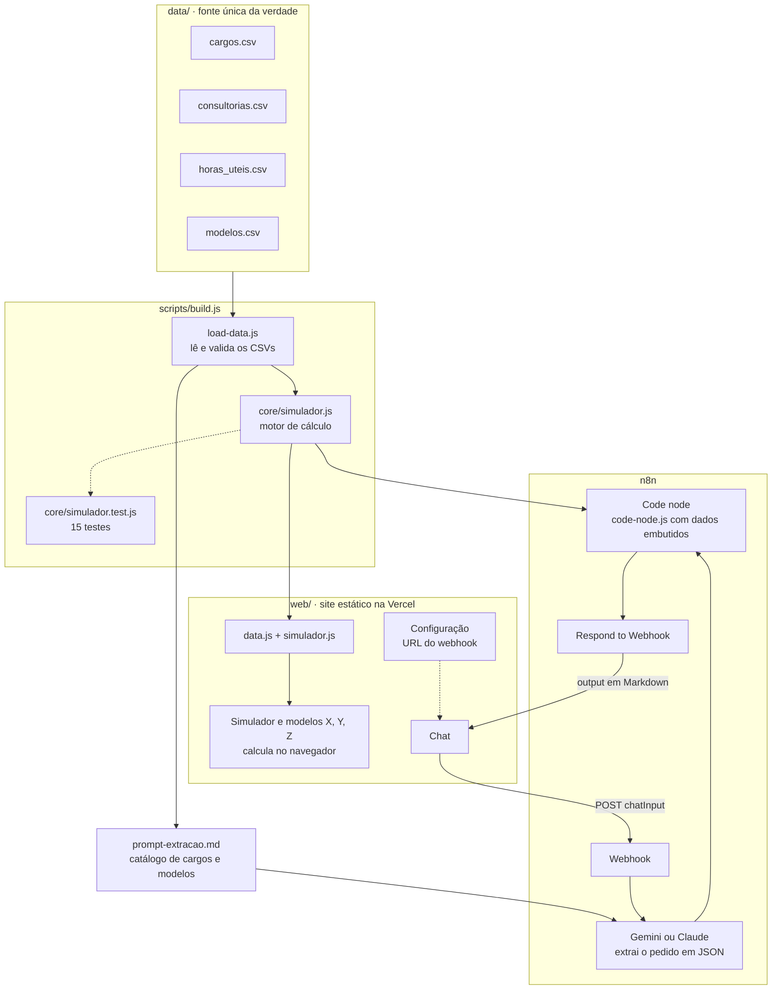
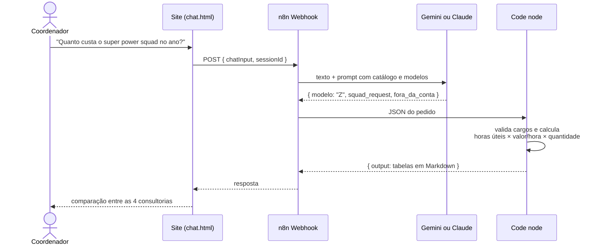
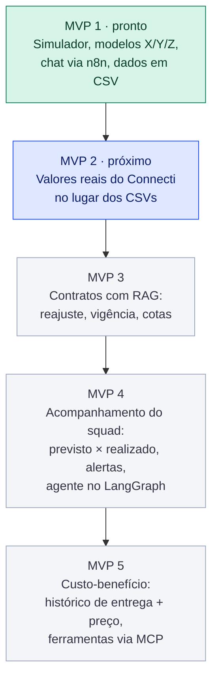
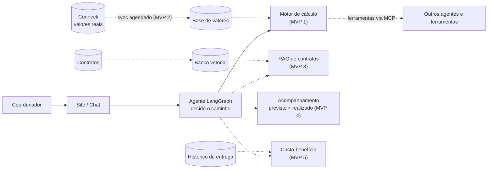

# Squad Cost Copilot

Compara o custo de montar um squad em cada consultoria de terceiros.
A IA entende o pedido em linguagem natural. O código faz a conta.

- **Site:** https://projeto-final-fiap-ia-experts.vercel.app
- **Repositório:** https://github.com/rogerboletadev/projeto-final-fiap-ia-experts

Projeto de estudo do curso FIAP Experts, feito por Rogerio Cardoso, Lorena Emmerick, Samuel Cruz e
Vitor Vilaronga. **Todos os valores e consultorias são fictícios.**

## O que dá para fazer

| Parte | Precisa de IA? | O que faz |
|---|---|---|
| Simulador (página inicial) | Não | Escolhe cargos, quantidades e período e compara o custo nas 4 consultorias |
| Modelos X, Y e Z (página inicial) | Não | Compara a estrutura atual, o power squad e o super power squad |
| Motor de cálculo e testes | Não | Roda no Node.js, sem instalar nenhuma dependência |
| Chat | Sim (n8n + Gemini ou Claude) | Recebe o pedido em texto livre, o modelo extrai os dados e o código calcula |

Ou seja: **sem IA nenhuma, o simulador, os modelos e os testes funcionam.** A IA só entra no chat.

## Rodar localmente (sem IA)

Você só precisa do [Node.js](https://nodejs.org) 18 ou mais novo. Não há `npm install`.

### 1. Baixar o projeto

```bash
git clone https://github.com/rogerboletadev/projeto-final-fiap-ia-experts.git
cd projeto-final-fiap-ia-experts
```

Sem git, baixe o .zip: https://github.com/rogerboletadev/projeto-final-fiap-ia-experts/archive/refs/heads/main.zip

### 2. Rodar os testes

```bash
node core/simulador.test.js
```

São 15 testes. Um deles confere à mão o total da Consultoria B (R$ 713.693,63), outro roda o código
do n8n simulando uma resposta do Claude.

### 3. Abrir o site

O site é estático (HTML, CSS e JavaScript puros), sem etapa de build. Suba um servidor local na pasta `web/`:

```bash
npx http-server web -p 5173
```

Depois abra http://localhost:5173. Se preferir Python: `python -m http.server 5173 --directory web`.

Dá para abrir `web/index.html` direto no navegador com dois cliques, mas pelo servidor local o
comportamento fica igual ao do site publicado. O Bootstrap e as fontes vêm de CDN, então sem internet
o simulador funciona, mas com visual simples.

## Como o cálculo funciona

```
valor/hora = valor base do cargo × fator da consultoria
custo      = horas úteis do período × valor/hora × quantidade
```

Os fatores são: A = 1, B = 1,1273, C = 1,2169 e D = 1,3147. O período usa as horas úteis de cada mês.

## Arquitetura

### MVP 1: como está hoje

Os CSVs são a fonte única da verdade. O build gera, a partir deles, os arquivos do site e do n8n,
então o simulador e o chat usam exatamente o mesmo motor de cálculo e os mesmos dados.



### Caminho de uma pergunta no chat

A IA só interpreta o texto e devolve um JSON. Todo número sai do código.



### Etapas dos MVPs



| Etapa | Entrega | Principal mudança na arquitetura |
|---|---|---|
| MVP 1 | Simulador, modelos X/Y/Z, chat | CSVs + motor de cálculo + n8n |
| MVP 2 | Valores reais | Fluxo agendado no n8n busca os valores no Connecti e atualiza a base |
| MVP 3 | Perguntas sobre contratos | Contratos quebrados em trechos, embeddings e banco vetorial (RAG) |
| MVP 4 | Acompanhamento do squad | Agente no LangGraph decide se a pergunta é de cálculo, contrato ou acompanhamento |
| MVP 5 | Melhor custo-benefício | Histórico de entrega por consultoria e perfil; cálculo exposto como ferramentas via MCP |

A ordem das etapas 3 a 5 ainda está em discussão no time.

### Arquitetura alvo

Em tracejado, o que ainda não existe.



## Estrutura

```
data/       base de dados em CSV (fonte única da verdade)
  cargos.csv          cargo e valor/hora base (os valores da Consultoria A)
  consultorias.csv    consultoria e fator
  horas_uteis.csv     horas úteis por mês
  modelos.csv         composição dos modelos X, Y e Z
core/       motor de cálculo e testes (sem dependências)
scripts/    build.js gera os arquivos do site e do n8n a partir dos CSVs
n8n/        o que colar no n8n: code-node.js e os prompts
web/        o site (pronto para a Vercel)
```

### Páginas do site

| Página | Arquivo |
|---|---|
| Simulador e modelos X, Y, Z | `web/index.html` |
| Chat (via n8n) | `web/chat.html` |
| Guia para montar o fluxo no n8n | `web/guia-n8n.html` |
| Roteiro do pitch de 5 minutos | `web/pitch.html` |
| Ideias do time | `web/ideias.html` |
| Arquitetura (diagramas deste README) | `web/arquitetura.html` |
| Fundadores e download do projeto | `web/equipe.html` |
| Configuração da URL do n8n | `web/config.html` |

## Mudar os dados

1. Edite os CSVs em `data/` (cargos, consultorias, horas úteis ou modelos).
2. Rode o build. Ele valida a base e regenera o site e os arquivos do n8n:

   ```bash
   node scripts/build.js
   ```

3. Rode os testes de novo.

Não edite à mão `web/data.js`, `web/simulador.js`, `web/n8n-assets.js`, `web/arquitetura-dados.js`,
`n8n/code-node.js` nem `n8n/prompt-extracao.md`: são gerados pelo build. Os diagramas da página de
arquitetura saem dos blocos Mermaid deste README; para mudar a arquitetura, edite aqui e rode o build.

## Modelos de squad

| Modelo | Nome | Time |
|---|---|---|
| X | Estrutura atual | Tech Lead, Arquiteto Federado, 2 Backend N3, 1 Frontend N3, 2 QA funcionais |
| Y | Power squad (como a instituição usa hoje) | Tech Lead, 2 Full Stack N3, 1 QA de automação |
| Z | Super Power Squad | 2 engenheiros de software Full Stack N3, com IA |

PM e IT Lead ficam fora da conta: normalmente não são recursos do coordenador de TI.
O valor do Arquiteto Federado (R$ 320/h) é fictício, como todos os outros.

## Ligar o chat (opcional, com IA)

O chat precisa de um fluxo no n8n. O passo a passo completo, com botões de copiar, está na página
**Guia do n8n** do site. Resumo dos nós, nesta ordem:

1. **Webhook** (POST) ou **Chat Trigger**. A mensagem chega em `chatInput`.
2. **Modelo de linguagem para extrair o pedido.** Pode ser o nó **Google Gemini** ou o nó **Anthropic**
   (Claude). System Message: o bloco de `n8n/prompt-extracao.md`. Mensagem: `{{ $json.chatInput }}`.
3. **Code.** Language: JavaScript, Mode: Run Once for All Items. Cole o conteúdo de `n8n/code-node.js`.
   Os dados já vão embutidos, então não precisa ler CSV nem instalar pandas.
4. **(Opcional) Comentário final.** Veja `n8n/prompt-comentario.md`. Ele só comenta; os números saem do código.
5. **Respond to Webhook**, devolvendo `{ "output": "..." }` (só se usou Webhook no passo 1).

Depois:

- No nó Webhook, em **Allowed Origins (CORS)**, coloque o endereço do site
  (ou `http://localhost:5173` para testar local).
- Na página **Configuração** do site, cole a Production URL do webhook e clique em **Testar conexão**.
  A URL fica salva só no seu navegador. Para valer para todos, coloque em `web/config.js`.

O prompt já entende os modelos pelo nome ("quanto custa o super power squad no ano?"), apelidos de cargo
(Tech Lead, QA, Arquiteto, engenheiro de software) e marca PM e IT Lead como fora da conta.

**Não testado num n8n real.** O código foi testado simulando a entrada do nó (formato do Gemini e do
Claude). Se algum nome de campo for diferente na sua versão do n8n, ajuste o bloco "Entrada" no fim de
`n8n/code-node.js`.

## Publicar na Vercel

A pasta `web/` é um site estático, sem build.

Pelo GitHub:

1. Na Vercel: Add New, Project, escolha o repositório.
2. Em **Root Directory**, coloque `web`. Framework Preset: Other. Build Command vazio.
3. Cada `git push` na `main` publica de novo.

Pela linha de comando:

```bash
cd web
npx vercel --prod
```

## Pontos de atenção

- **Backend N1 da Consultoria B.** Na planilha original está 133,56, mas pela regra base × fator deveria
  ser 112,73. Era a única das 68 linhas fora da regra. Na base nova o valor é calculado, então o erro some.
  Vale confirmar o valor correto no contrato.
- **Júnior, pleno, sênior.** O prompt assume que significam N1, N2 e N3. É uma hipótese a confirmar.
- **Dados reais.** Valor/hora de terceiros é dado contratual sensível. Antes de usar dados do Connecti
  ou um LLM em nuvem com dados reais, alinhe com segurança.

## Próximas versões

- **Valores reais do Connecti:** buscar os valores direto da ferramenta em vez de manter CSVs à mão.
- **Contratos com RAG:** reajuste, vigência, troca de nível e cotas.
- **Acompanhamento do squad:** previsto × realizado, alertas e um agente no LangGraph.
- **Custo-benefício:** somar histórico de entrega ao preço, e não só buscar o mais barato.
